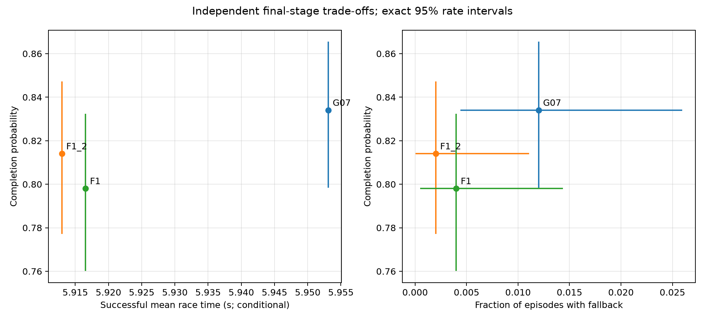
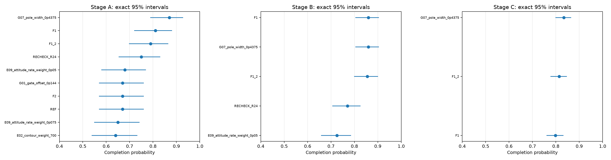

# MPCC comparative campaign — final technical report

## 1. Recommendation

**Primary recommendation: G07_pole_width_0p4375**, `config_3742dfc435fa9211`, using the complete frozen settings in manifest.json. It has the highest observed final-stage completion in this campaign: 417/500 (83.4%), exact 95% CI [79.8%, 86.6%], with 9.945 s failure-penalized mean. This ordering describes observed results; the paired evidence below determines whether a superiority claim is supported. Do not interpret an ordinal rank as a statistically established winner.

**Completion superiority:** No unique completion winner is established against all finalists. The primary recommendation is a practical default within unresolved differences, not a claim of proven superiority or equivalence.

Strong alternatives: F1_2, F1. F1_2 is the strongest balanced alternative, with fewer observed fallback episodes and faster successful races; population-rate differences remain uncertain. The maximum-observed-robustness choice is G07_pole_width_0p4375; the fastest final-stage successful mean is F1_2 (5.913 s); the lowest observed mean controller cost is F1_2 (2.205 ms). Speed and compute alternatives are restricted to confirmed finalists; screening-only candidates do not receive equivalent validation status.

## 2. Selection and historical evidence

Ten runnable configurations were selected from the resolved official-core group before new race outcomes were inspected. See candidate_selection.md. All ten supplied suggestions were retained: the three 84/100 leaders, two E09 weights, G01 gate offset, E02 contour cost, F2, REF, and RECHECK_R24. The E09 pair tests sensitivity to weighting despite identical historical finish counts. F1/F1_2 directly tests offsets 0.180/0.162. Small-n apparent leaders and redundant multi-change relatives were excluded. The prior comprehensive audit (106 PASS, 0 FAIL, 33 NOT_VERIFIED) was not repeated. Targeted implementation/environment hash checks were necessary to reconstruct runnable controllers.

The retained 596-cohort/420-configuration assessment, its configuration/cohort metrics, paired comparisons, validation comparisons, data dictionary, phase-4 direct F1 review, and original pinned source snapshots informed selection. Independent validation often reduced earlier completion estimates; fresh confirmation therefore takes precedence. Historical modified-core candidates (including incumbent and opt_a758e8cb3e87) remain in historical_modified_candidates.json with their own environment identities. Their legacy implementations, source environments, much slower trajectories and incomplete timing closure preclude direct pooling. They were considered but not promoted into this ten-candidate campaign. No claim that they are inferior under the new environment follows from their exclusion.

The seven alpha rankings are exploratory, correlated indicators. Original numeric alpha_5/10/15/20/25/30/50 artifacts were not located in retained docs/research; their columns are missing rather than fabricated. Selection uses underlying completion, confidence bounds, time, health, sample size, and source identity. This is a limitation in recovering the requested contextual ranking data.

## 3. Design and controls

Hardware: Intel(R) Core(TM) Ultra 7 258V. Python 3.13.15. Runtime versions: numpy 2.5.2, scipy 1.18.0, jax 0.11.0, jaxlib 0.11.0, mujoco 3.10.0, crazyflow 0.4.0, gymnasium 1.4.0, casadi 3.7.2, acados-template 0.1. CPU JAX; BLAS/OpenMP thread counts fixed to one.

Stage A: 10 × 100; Stage B: 5 × 200; Stage C: 3 × 500, for 3,500 measured races. These runtime-adjusted sizes were frozen in runtime_design.json before A. Rebuilt episodes cost about 5 s; validated build reuse reduced this to about 1 s. Increasing independent sample sizes reserve most evidence for confirmation. Individual n=500 completion intervals near 80% have roughly ±4 percentage points uncertainty. Small differences can remain unresolved. There was no outcome-dependent stopping or parameter tuning.

Selection rule at A and B: descending finishes, ascending 30-second-penalized mean, ascending failed solver ticks, then ascending pooled call p99. Five finalists then three finalists were selected. Configurations and all seed lists were frozen before collection; stage-specific plan files and SHA256 files identify actual prefixes. Stage C was not inspected for candidate selection or tuning. Source and library hashes are checked on each launch.

All simulations use the isolated retained official-core source package, CPU JAX, 50 Hz attitude interface, 500 Hz dynamics, nominal Level 2 gate order, original randomizations and disturbances. The active repository simulator/configuration was not changed. This is a new fully specified runtime environment, not proof of historical binary equivalence; historical and new samples are not pooled. Full package versions, hardware/CPU affinity, source and library pins, runtime origins, and git state are retained in provenance.json, manifest.json and per-stage runtime.json. Desktop background load was not eliminated; timings are serial and comparable in workload but not hard-real-time certification.

Fresh deterministic seeds were generated with NumPy seed 202611121739 and checked against all explicit seeds recoverable from normalized retained evidence. Full reset EnvData tree arrays, including randomized hidden track/dynamics and PRNG state, are stored in states/*.npz with dtype/shape-sensitive SHA256 hashes. Hash equality is asserted across candidates on every paired seed. Float arrays and initial observations are retained; unknown external/unretained seed usage cannot be excluded. Seed order is shared and candidate order rotates by seed to spread load drift.

Each controller is newly constructed each race. Build reuse caches a separate solver per exact settings identity and updates the path-length bounds for each new initial position. No controller computation or official physics source was edited. All ten × three smoke outcomes and terminal observations agreed with rebuilding; six F1/REF action traces were additionally checked: maximum float64 difference <5e-15 and every float32 action exactly identical. See cache_validation.json and cache_trace_validation.json. Smoke and technical trace data are excluded from performance estimates. This finite check is evidence of immaterial behavior change, not a mathematical proof for every possible state.

Race time is completed control steps / 50, matching the retained study convention. Original zero-based official time is also saved per episode (one 20 ms tick lower). Failed races score 30 s regardless of observed failure duration. Whole compute_control calls are timed, excluding solver construction, simulator steps, callbacks and terminal diagnostics; pooled p99 and >20 ms counts use all calls, including failed races. Fallback is explicitly observed at the unique hover branch (_prediction is None), verified against source; solver status is saved per tick. Internal QP iteration histories and each RTI subsolve are not collected, so failed_solver_ticks counts final reported nonzero status ticks, not iterations. Missing telemetry is never interpreted as zero.

## 4. Results by stage

### Stage A

| Candidate | Finishes | Completion, exact 95% CI | Penalized s | Success mean / p90 s | Failed / fallback ticks | Mean / p99 ms | >20 ms calls |
|---|---:|---|---:|---|---|---|---:|
| G07_pole_width_0p4375 | 87/100 | 87.0% [78.8, 92.9] | 9.057 | 5.927 / 6.028 | 0 / 0 | 2.267 / 8.161 | 1 |
| F1 | 81/100 | 81.0% [71.9, 88.2] | 10.482 | 5.904 / 6.020 | 0 / 0 | 2.259 / 8.139 | 0 |
| F1_2 | 79/100 | 79.0% [69.7, 86.5] | 10.960 | 5.899 / 6.000 | 0 / 0 | 2.256 / 8.182 | 0 |
| RECHECK_R24 | 75/100 | 75.0% [65.3, 83.1] | 11.769 | 5.693 / 5.800 | 3 / 3 | 2.293 / 8.204 | 1 |
| E09_attitude_rate_weight_0p05 | 68/100 | 68.0% [57.9, 77.0] | 13.572 | 5.841 / 5.920 | 0 / 0 | 2.289 / 8.255 | 1 |
| G01_gate_offset_0p144 | 67/100 | 67.0% [56.9, 76.1] | 13.833 | 5.870 / 5.968 | 0 / 0 | 2.276 / 8.145 | 2 |
| F2 | 67/100 | 67.0% [56.9, 76.1] | 13.836 | 5.875 / 5.980 | 0 / 0 | 2.267 / 8.219 | 0 |
| REF | 67/100 | 67.0% [56.9, 76.1] | 13.839 | 5.879 / 5.968 | 0 / 0 | 2.269 / 8.200 | 0 |
| E09_attitude_rate_weight_0p075 | 65/100 | 65.0% [54.8, 74.3] | 14.310 | 5.862 / 5.952 | 0 / 0 | 2.268 / 8.182 | 0 |
| E02_contour_weight_700 | 64/100 | 64.0% [53.8, 73.4] | 14.550 | 5.859 / 5.954 | 0 / 0 | 2.274 / 8.176 | 1 |

### Stage B

| Candidate | Finishes | Completion, exact 95% CI | Penalized s | Success mean / p90 s | Failed / fallback ticks | Mean / p99 ms | >20 ms calls |
|---|---:|---|---:|---|---|---|---:|
| F1 | 172/200 | 86.0% [80.4, 90.5] | 9.278 | 5.905 / 6.020 | 0 / 0 | 2.205 / 8.086 | 0 |
| G07_pole_width_0p4375 | 172/200 | 86.0% [80.4, 90.5] | 9.304 | 5.935 / 6.060 | 1 / 1 | 2.211 / 8.099 | 2 |
| F1_2 | 171/200 | 85.5% [79.8, 90.1] | 9.395 | 5.901 / 6.000 | 0 / 0 | 2.209 / 8.084 | 2 |
| RECHECK_R24 | 154/200 | 77.0% [70.5, 82.6] | 11.287 | 5.698 / 5.814 | 0 / 0 | 2.238 / 8.168 | 1 |
| E09_attitude_rate_weight_0p05 | 145/200 | 72.5% [65.8, 78.6] | 12.485 | 5.842 / 5.940 | 0 / 0 | 2.229 / 8.158 | 1 |

### Stage C

| Candidate | Finishes | Completion, exact 95% CI | Penalized s | Success mean / p90 s | Failed / fallback ticks | Mean / p99 ms | >20 ms calls |
|---|---:|---|---:|---|---|---|---:|
| G07_pole_width_0p4375 | 417/500 | 83.4% [79.8, 86.6] | 9.945 | 5.953 / 6.080 | 37 / 37 | 2.208 / 8.033 | 4 |
| F1_2 | 407/500 | 81.4% [77.7, 84.7] | 10.393 | 5.913 / 6.020 | 6 / 6 | 2.205 / 8.042 | 2 |
| F1 | 399/500 | 79.8% [76.0, 83.2] | 10.781 | 5.917 / 6.040 | 7 / 7 | 2.207 / 8.058 | 3 |

## 5. Paired comparisons and uncertainty

All comparisons are candidate minus reference; positive completion differences favor the candidate and negative time differences favor it. Completion differences use conservative paired intervals formed from Bonferroni exact rescue/regression cell bounds. This interval has at least 95% coverage under iid paired episodes; bootstrap completion intervals are also retained as exploratory summaries. Exact two-sided McNemar p-values are Holm-adjusted over all pairs within each stage (45, 10, and 3). Penalized and shared-success mean differences use 10,000 deterministic paired bootstrap resamples. Those time intervals are pointwise; they do not establish simultaneous significance. Practical reference margins are 3 percentage points completion and 0.5 s penalized time; failure to reject a difference is not evidence of equivalence.

| Stage C: reference → candidate | Rescues / regressions | Completion Δ pp [95% CI] | Holm p | Penalized Δ s [95% bootstrap CI] | Shared-success Δ s [95% CI], n |
|---|---|---|---|---|---|
| F1 → F1_2 | 14 / 6 | 1.60 [-1.41, 4.57] | 0.2306 | -0.388 [-0.821, -0.002] | -0.0049 [-0.0059, -0.0039], 393 |
| F1 → G07_pole_width_0p4375 | 38 / 20 | 3.60 [-1.27, 8.40] | 0.07424 | -0.837 [-1.556, -0.116] | 0.0341 [0.0307, 0.0377], 379 |
| F1_2 → G07_pole_width_0p4375 | 31 / 21 | 2.00 [-2.66, 6.62] | 0.2306 | -0.448 [-1.123, 0.225] | 0.0393 [0.0359, 0.0427], 386 |

All A/B paired comparisons, including F1 references where retained, are in paired_comparisons.csv. Stage A and B are selection evidence; C alone supplies final independent evaluation. Success-only comparisons condition on joint completion and cannot replace unconditional completion or penalized time.

## 6. Practical interpretation

F1 versus F1_2: no completion superiority is established after Holm adjustment. The conservative paired interval does not establish practical equivalence within ±3 pp.

F1 versus G07_pole_width_0p4375: no completion superiority is established after Holm adjustment. The conservative paired interval does not establish practical equivalence within ±3 pp.

F1_2 versus G07_pole_width_0p4375: no completion superiority is established after Holm adjustment. The conservative paired interval does not establish practical equivalence within ±3 pp.

## 7. Failure mechanisms and starting conditions

The official environment warps disabled drones to [-1,-1,-1], so terminal observations cannot identify the impact. A read-only replay of the final pre-step state and action recovers pre-warp position and contacts using official action disturbance, dynamics and collision functions. The replay does not affect controller or simulator continuation. Contact geometry/body identifiers, penetration distances and prewarp position are saved. Contact classifications are diagnostic replay evidence; failures without recovered gate/pole contacts are kept unresolved rather than assigned a fabricated mechanism. Upper-frame classification depends on geometry names; unclassified gate frames remain in the gate-contact category.

| Stage / candidate | Gate | Pole | Timeout | Bounds / unresolved |
|---|---:|---:|---:|---:|
| A / RECHECK_R24 | 12 | 13 | 0 | 0 |
| A / F2 | 7 | 26 | 0 | 0 |
| A / REF | 6 | 27 | 0 | 0 |
| A / E09_attitude_rate_weight_0p05 | 5 | 27 | 0 | 0 |
| A / F1_2 | 8 | 13 | 0 | 0 |
| A / F1 | 7 | 12 | 0 | 0 |
| A / G07_pole_width_0p4375 | 10 | 3 | 0 | 0 |
| A / E09_attitude_rate_weight_0p075 | 6 | 29 | 0 | 0 |
| A / E02_contour_weight_700 | 8 | 28 | 0 | 0 |
| A / G01_gate_offset_0p144 | 7 | 26 | 0 | 0 |
| B / E09_attitude_rate_weight_0p05 | 15 | 40 | 0 | 0 |
| B / F1_2 | 18 | 11 | 0 | 0 |
| B / F1 | 14 | 14 | 0 | 0 |
| B / G07_pole_width_0p4375 | 22 | 6 | 0 | 0 |
| B / RECHECK_R24 | 30 | 16 | 0 | 0 |
| C / G07_pole_width_0p4375 | 60 | 23 | 0 | 0 |
| C / F1 | 50 | 51 | 0 | 0 |
| C / F1_2 | 49 | 44 | 0 | 0 |

Starting-condition strata and per-seed difficulty are exploratory diagnostics, not new independent tests. failure_analysis.csv retains initial position, gate progress and terminal coordinates; prewarp positions and contact bodies are in episode JSON. Initial-condition effects may reflect randomized hidden gates, mass and inertia as well as starting pose. A single-variable association cannot establish causation.

## 8. Numerical and computational reliability

numerical_computational_health.csv gives full measured coverage for every candidate/stage. All configurations share broad-core implementation complexity 2, using two RTI passes, gate-path deformation, pole avoidance and thrust adaptation. Parameter-only changes do not change implementation complexity. A failed tick can recover without losing the race; race completion does not erase such events. Explicit fallback and nonzero solver status counts are separate. Historical G07 had 13 failed ticks across three screening episodes; the new tables establish whether that concern recurs. Deadline overruns use the 20 ms controller period. Pooled p99 is computed from raw per-call samples, never averaged from episode percentiles.

## 9. Historical comparison

Historical official screening F1/F1_2/G07 each finished 84/100; F1_2 rescued two and regressed two against F1, with only a 5.6 ms shared-success advantage and missing initial-state vectors. The new campaign supplies verified state pairing and independent selection/confirmation. Apparent historical gains may regress after selection, and raw rates across disjoint cohorts need uncertainty. Historical modified-core completion/time evidence remains environment-specific. Its conditional box-contact fix is absent here.

## 10. Limitations

Only the nominal Level 2 randomization distribution was tested. No hardware flight, alternative track, wind-domain shift, multi-drone traffic or GPU timing validation is implied. The reduced screening/confirmation sizes provide less precision than the initial 200/500/1000 framework. Three finalists give limited independent coverage of eliminated candidates. Pointwise time bootstrap intervals and exploratory failure strata are not multiplicity-corrected causal evidence. Full initial-state arrays support replay but cross-version deterministic equivalence is not guaranteed. Source files and shared libraries are frozen; package manifests do not prove every system library/kernel instruction path identical to historical experiments. Build-reuse equivalence was tested on finite smoke cases. Original numeric alpha scores were unavailable. The final recommendation is restricted to the tested distribution and environment.

## 11. Deployment choice

Use **G07_pole_width_0p4375** as the primary practical foundation under the frozen environment. Preserve its entire settings object and verified implementation bundle; copying the case name or gate-offset value alone is insufficient. Alternatives are F1_2, F1; use the paired uncertainty above to decide whether selecting one is a practical preference within unresolved differences. Speed choice: F1_2; measured mean-cost choice: F1_2. No speed recommendation overrides a material completion disadvantage.

## 12. Reproduction

From the repository root (the campaign source snapshot is already frozen):

```bash

export LD_LIBRARY_PATH="$PWD/acados/lib${LD_LIBRARY_PATH:+:$LD_LIBRARY_PATH}"

.pixi/envs/default/bin/python docs/control/mpcc_campaign_20261112_v1/orchestrate.py

.pixi/envs/default/bin/python docs/control/mpcc_campaign_20261112_v1/finalize.py

```

The orchestrator resumes missing episode files and refuses changed frozen plans/sources. To rerun from scratch, copy the campaign to a new sibling directory and remove A/B/C, selection_B/C.json and their hashes, orchestration logs and generated summaries in that copy; retain manifest, seeds, source, runtime_design and validation evidence. Do not rerun prepare.py over an existing campaign. Individual stage commands are `run.py --stage A --cache` (then B/C after frozen selections). Exact prefix seed lists are in stage plan.json; full reserved lists are seeds_A/B/C.json. Raw episode JSON includes actions, timing arrays, numerical status, settings hash, exact-state reference and execution timestamp. CSVs and charts are derived artifacts; original assessment/data remain untouched.

## Additional technical interpretation

Source: `source/lsy_drone_racing/control/mpcc_broad_core.py`, especially `_update_gate_path()` and `compute_control()`; cost construction in `mpcc_broad_solver.py`.

G07 changes only `pole_width` from 0.39375 to 0.4375. This is the Gaussian width **along path progress** over which each pole-avoidance correction is spread, followed by projection that preserves gate anchors. It does not change the physical pole clearance threshold: `obstacle_clearance` remains 0.26 m. Wider support can change the bend and approach to a pole, but does not by itself prove a larger minimum physical separation. Paired rescue impacts and regressions are needed to assess the effect.

F1_2 changes only `gate_offset` from 0.180 to 0.162. This changes the approach/departure anchor positions and normal offsets around each gate; the center target remains unchanged with gate_center_snap=1.0. It changes local deformation geometry rather than moving the gate-center goal by 18 mm. A faster successful mean does not establish a robustness benefit.

The E09 0.05 and 0.075 candidates differ only in the attitude-rate cost from each other. Relative to F1 they also use pole_width=0.35, so E09-versus-F1 is not an isolated attitude-rate intervention. Their lower rate penalty permits less heavily penalized rotation rates, but any causal explanation based on that alone must remain a hypothesis. The direct E09 pair in Stage A isolates the weight within the same geometry.

All configurations use the same post-gate frame-clearance deformation, two RTI passes, state/control bounds and adaptation logic unless an explicit setting difference is recorded. Nonzero final solver status or non-finite predictions/inputs triggers the unique hover branch and solver reset. Status zero is not a guarantee of collision avoidance or globally optimal control.

Numerical status codes come from the pinned acados source `acados/utils/types.h`: ACADOS_QP_FAILURE=4. A log message giving underlying QP status=3 must not be mislabeled as acados status=3 (ACADOS_MINSTEP).

The faster RECHECK_R24 trades 9.0 percentage points of Stage B completion against 0.208 s of conditional successful time. That trade-off does not justify replacing the stronger completion candidates for this task.

G07 Stage A: 0/100 episodes with nonzero solver status, 0 failed ticks and 0 fallback activations. The historical 13-tick concern must be interpreted against these fresh observations rather than assumed to recur at its original rate.

G07 Stage B: 1/200 episodes with nonzero solver status, 1 failed ticks and 1 fallback activations. The historical 13-tick concern must be interpreted against these fresh observations rather than assumed to recur at its original rate.

G07 Stage C: 6/500 episodes with nonzero solver status, 37 failed ticks and 37 fallback activations. The historical 13-tick concern must be interpreted against these fresh observations rather than assumed to recur at its original rate.

Stage A reference contrasts (exploratory selection evidence):

E09_attitude_rate_weight_0p05 → F1: 14 rescues, 1 regressions; completion difference 13.0 pp; Holm-adjusted exact p=0.03125.

F1 → REF: 0 rescues, 14 regressions; completion difference -14.0 pp; Holm-adjusted exact p=0.0047607.

G07_pole_width_0p4375 → REF: 3 rescues, 23 regressions; completion difference -20.0 pp; Holm-adjusted exact p=0.003607.

## Numerical replay and environment diagnosis

All 11 numerically affected measured episodes were replayed with isolated fresh solver builds. Every replay reproduced the original float32 actions, race steps, outcomes and fallback counts exactly. The initial diagnostic library-reuse issue and its correction are documented in infrastructure_notes.md; its archived nonisolated outputs are excluded from inference. A cached-build control replay is retained separately. The additional getter instrumentation is outside measured timing data.

All first fallback states had at least one measured Euler angle outside the configured ±0.7-radian hard state bound. The captured subsolve returned acados QP_FAILURE=4 with HPIPM NAN_SOL=3. This supports a hypothesis of numerical difficulty near infeasible attitude-bound recovery; it does not prove which constraint caused failure. Ten of the 11 affected races ultimately finished. Broadening/softening bounds would be a new exploratory tuning campaign and was not done on confirmation seeds.

The initialization RuntimeWarning was traced separately to MuJoCo 3.10.0 box-box collision code converting jp.finfo(float).max into the active float32 dtype. No simulator patch or precision change was applied. It is an environment-level collision-sentinel warning rather than an observed controller-output NaN. Its presence does not establish collision correctness or harmlessness; results remain specific to this frozen official-core/runtime combination. See initialization_warning_trace.txt.

Numerical-event exact intervals and paired tests are in health_confidence_intervals.csv and paired_health_comparisons.csv. In the final stage, G07 had 6/500 affected episodes, F1 2/500, and F1_2 1/500. The larger observed G07 burden recurs, but sparse event counts limit inference about population-rate differences.

Mechanistic paired evidence: against F1, G07 rescued 38 final-stage seeds (27 pole failures and 11 gate failures in F1) and regressed on 20 seeds, all gate-contact failures in G07. This supports a pole-versus-gate trade-off rather than universal dominance. Upper-frame cluster counts were 19 G07, 12 F1, and 12 F1_2; cluster labels can overlap within a failed episode. Across all three finalists, 58/500 seeds defeated every controller and 377/500 were finished by all three.

Exploratory starting-condition sensitivity: in the second quartile of initial x (approximately [-1.5477, -1.4981) m), G07 finished 109/125, F1_2 100/125, and F1 97/125. That stratum accounts for nine of G07's ten net additional finishes versus F1_2 and 12 of its 18 versus F1. The observed gain is concentrated, rather than uniform across starting positions. This post-hoc subgroup comparison is not multiplicity-adjusted or causal: hidden gate/dynamics randomizations and chance can explain associations. It limits extrapolation to changed starting distributions; no tuning was performed from these strata.

F1_2 versus F1 rescued 14 and regressed six final-stage seeds. The smaller gate offset yielded a 1.6 pp observed gain, but conservative paired 95% bounds [-1.41, 4.57] pp and Holm p=0.231 do not establish robustness superiority or ±3 pp equivalence. Its shared-success speed advantage was only 4.9 ms. The final-stage mean compute differences between finalists have paired bootstrap intervals spanning zero, so no meaningful computational-efficiency winner is established.

The empirical Pareto frontier among confirmed finalists is G07 and F1_2: G07 has the highest completion and lowest penalized-time point estimates; F1_2 has faster successful races and fewer observed fallback events. F1 is dominated on these point estimates, but population dominance is not established.





[Detailed technical findings](technical_findings.md); [Failure clusters](failure_clusters.csv); [Starting-condition sensitivity](initial_condition_sensitivity.csv); [Paired compute comparisons](paired_compute_comparisons.csv); [Artifact audit](audit.json).
